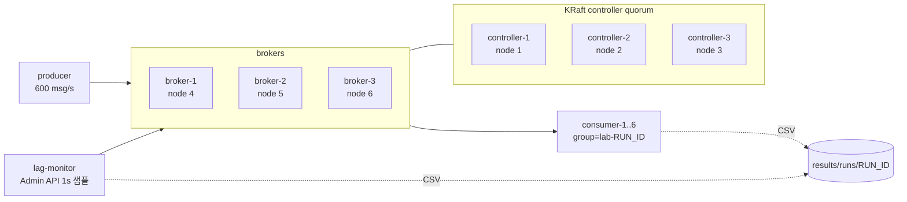

# 01. 환경 구성

실험 인프라의 구성, 기동 절차, 실험 애플리케이션의 동작 방식을 기술한다. 실험 전에 한 번 끝까지 읽고 `cluster.sh up`까지 진행한다.

## 1. 사전 준비

| 항목 | 기준 | 확인 명령 |
|---|---|---|
| Docker Desktop | Compose v2 포함, 메모리 할당 8GB 이상(10GB 권장) | `docker info --format '{{.MemTotal}}'` |
| CPU | 4코어 이상 할당 | `docker info --format '{{.NCPU}}'` |
| python3 | 3.8 이상, 표준 라이브러리만 사용 | `python3 --version` |
| 디스크 | 이미지와 실험 기록용 2GB 이상 | |

JVM은 컨테이너 14개(controller 3, broker 3, consumer 6, producer, lag-monitor)가 동시에 뜬다. 힙 합계는 약 3.7GB이고, 메모리 할당이 부족하면 GC 정지가 리밸런싱 측정값에 섞이므로 Docker Desktop의 Resources 설정을 먼저 확인한다.

로컬에 JDK와 Maven은 필요 없다. 애플리케이션 이미지는 Docker 멀티 스테이지 빌드로 만든다.

## 2. 구성



| 구성 요소 | 내용 |
|---|---|
| 이미지 | `apache/kafka:4.1.2` (`KAFKA_VERSION` 환경 변수로 변경) |
| controller | `process.roles=controller`, 정적 voter 3대(`controller.quorum.voters`). 동적 quorum(KIP-853)은 Phase 6 범위다. |
| broker | `process.roles=broker`, 내부 리스너 `broker-N:9092`, 호스트 리스너 `localhost:19092~19094` |
| 토픽 | `lab-events`, 파티션 12, RF 3, `min.insync.replicas=2` |
| 내부 토픽 | `__consumer_offsets` RF 3 |
| 데이터 | 컨테이너 내부 `/tmp/kraft-logs`. `cluster.sh down`이면 모두 사라진다. |

파티션 12개는 컨슈머 6대일 때 멤버당 2개, 스케일 아웃 전 3대일 때 멤버당 4개로 나누어 떨어지게 정한 값이다. 할당 불균형이 측정값에 섞이지 않는다.

### 그룹 관련 브로커 설정

4.1 기본값과 같지만 실험 조건을 문서와 일치시키기 위해 `docker-compose.yml`에 명시했다.

| 설정 | 값 | 영향 |
|---|---|---|
| `group.initial.rebalance.delay.ms` | 3000 | classic 그룹이 비어 있을 때 첫 JoinGroup을 모으는 대기 시간. 실험 시작 시점에만 영향이 있다. |
| `group.consumer.session.timeout.ms` | 45000 | consumer 프로토콜 멤버의 세션 타임아웃. 브로커가 결정한다. |
| `group.consumer.heartbeat.interval.ms` | 5000 | consumer 프로토콜 하트비트 주기. 브로커가 응답으로 내려준다. |
| `group.consumer.assignors` | uniform,range | 서버 측 할당자. 첫 항목이 기본값이다. |
| `group.consumer.migration.policy` | bidirectional | 비어 있지 않은 그룹의 classic↔consumer 온라인 전환 허용 범위. `MIGRATION_POLICY` 환경 변수로 바꾼다. |

classic 쪽 대응 값은 클라이언트 설정이며 4.1 기본값을 그대로 쓴다. `session.timeout.ms=45000`, `heartbeat.interval.ms=3000`이다. 두 프로토콜의 세션 타임아웃이 같으므로 kill -9 시나리오의 장애 감지 시간은 같은 조건에서 비교된다.

## 3. 기동

```bash
./scripts/cluster.sh up       # 이미지 빌드, controller/broker 기동, 토픽 생성, 상태 출력
./scripts/cluster.sh status   # 컨테이너, quorum, feature, 토픽 상태
./scripts/cluster.sh down     # 전체 삭제(데이터 포함)
./scripts/cluster.sh reset    # down 후 up
```

`up` 출력에서 다음을 확인한다.

- `metadata quorum`: `LeaderId`가 1~3 중 하나이고 `CurrentVoters`가 3개, `CurrentObservers`가 broker 3개(4, 5, 6)다.
- `features`: `group.version` FinalizedVersionLevel이 1이다. 0이면 consumer 프로토콜을 쓸 수 없다.
- `topic`: 12개 파티션 모두 `Isr`에 3개 브로커가 있다.

여기까지 확인했으면 Phase 1의 내용(controller quorum, ISR, `min.insync.replicas`)이 실제 클러스터에서 어떻게 보이는지도 함께 확인한 것이다.

## 4. 실험 애플리케이션

`lab-app/`은 하나의 이미지로 세 가지 역할을 한다. 모든 기록은 `results/runs/<RUN_ID>/`에 CSV로 남는다.

### producer

- 초당 `RATE`(기본 600)건을 `acks=all`, 멱등 프로듀서로 보낸다.
- 파티션을 `seq % 12`로 순환 지정한다. 파티션마다 초당 50건이 균일하게 들어오므로 파티션별 처리 공백을 정지 시간으로 해석할 수 있다.

### consumer (consumer-1 ~ consumer-6)

설정 프로파일(`settings/*.env`)에 따라 `group.protocol`, 할당자, `group.instance.id`를 정한다.

| 동작 | 구현 |
|---|---|
| 처리 | 레코드마다 `PROCESS_MS`(기본 2ms) 동안 sleep 후 `processed-<member>.csv`에 기록한다. 이 기록을 "처리 완료"로 정의한다. |
| 커밋 | `enable.auto.commit=false`. 배치 처리 후 기록을 flush하고 `commitAsync`한다. |
| revoke | `onPartitionsRevoked`에서 해당 파티션의 처리 완료 오프셋을 `commitSync`한다. 정상 리밸런싱에서 중복이 생기지 않게 하는 표준 구현이다. |
| lost | `onPartitionsLost`에서는 커밋하지 않고 대기 중 오프셋을 버린다. |
| 종료 | SIGTERM을 받으면 `wakeup()` 후 대기 오프셋을 `commitSync`하고 `close()`한다. |
| 지연 주입 | `control/<member>.stall` 파일이 생기면 다음 배치 처리 전에 파일에 적힌 시간(ms)만큼 멈춘다. |
| 프로토콜 덮어쓰기 | 시작 시 `control/<member>.protocol` 파일이 있으면 그 값을 `group.protocol`로 쓴다. 마이그레이션 실습에서 사용한다. |
| 메트릭 | 5초마다 `consumer-coordinator-metrics` 그룹의 수치를 `metrics-<member>.csv`에 기록한다. |
| JMX | `localhost:9101~9106`으로 원격 JMX를 연다. jconsole, VisualVM으로 접속할 수 있다. |

consumer 프로토콜일 때는 `partition.assignment.strategy`, `session.timeout.ms`, `heartbeat.interval.ms`를 설정하지 않는다. 4.1 클라이언트는 이 설정이 있으면 `ConfigException`으로 기동을 거부한다(`ConsumerConfig.CONSUMER_PROTOCOL_UNSUPPORTED_CONFIGS`).

### lag-monitor

Admin API로 1초마다 다음을 기록한다. 컨슈머 내부 상태와 별개로 브로커가 보는 그룹 상태를 남기는 역할이다.

- `group.csv`: 그룹 type(Classic/Consumer), state, 멤버 수, group epoch, 할당된 파티션 수, 프로토콜별 멤버 수
- `members.csv`: 멤버별 client id, instance id, member epoch, `upgraded`(consumer 그룹 안에서 consumer 프로토콜을 쓰는지), 할당 파티션
- `lag.csv`: 커밋 오프셋 기준 파티션별 lag과 합계

## 5. 실험 파라미터

환경 변수로 덮어쓴다. 예: `RATE=1200 PROCESS_MS=1 ./scripts/run.sh eager kill9`

| 변수 | 기본값 | 의미 |
|---|---|---|
| `RATE` | 600 | 프로듀서 초당 전송 건수 |
| `PROCESS_MS` | 2 | 레코드당 처리 시간. 컨슈머 1대의 최대 처리량은 약 `1000/PROCESS_MS`건/초다. |
| `MAX_POLL_INTERVAL_MS` | 30000 | 기본값 300000을 줄여 처리 지연 시나리오를 짧게 만든다. 모든 설정에 같은 값을 적용한다. |
| `MAX_POLL_RECORDS` | 100 | 배치 크기. 지연 시 중복 건수의 상한에 영향을 준다. |
| `WARMUP_SEC` | 20 | 그룹 안정화 후 트리거 전 대기 시간 |
| `OBSERVE_SEC` | 90 | 트리거 후 관찰 시간. 세션 타임아웃(45초)보다 충분히 길어야 한다. |
| `ROLL_INTERVAL_SEC` | 10 | 롤링 재시작 시 멤버 간 간격 |
| `TARGET_MEMBER` | consumer-3 | kill -9, 처리 지연 대상 |
| `SESSION_TIMEOUT_MS` | (미설정) | classic 전용 `session.timeout.ms`. 설정하면 두 프로토콜의 감지 조건이 달라지므로 비교 실험에서는 쓰지 않는다. |

기본값에서 컨슈머 1대의 부하는 파티션 2개 × 50건/초 × 2ms = 처리 능력의 20%다. 리밸런싱 후 backlog를 따라잡을 여유를 남기면서도 lag 피크가 눈에 보이도록 잡은 값이다.

## 6. run 디렉터리 구성

| 파일 | 내용 |
|---|---|
| `run.env` | 이번 run의 설정과 파라미터 |
| `markers.csv` | `WARMUP_DONE`, `TRIGGER`, 동작(재시작/kill/지연), `OBSERVE_END` 시각 |
| `events-<member>.csv` | START, ASSIGNED, REVOKED, LOST, COMMIT_FAILED, STALL_BEGIN/END, CLOSE |
| `processed-<member>.csv` | 처리 시각, 파티션, 오프셋, 프로듀스 시각 |
| `metrics-<member>.csv` | 코디네이터 메트릭 스냅샷 |
| `group.csv`, `members.csv`, `lag.csv` | lag-monitor 기록 |
| `describe-*.txt` | `kafka-consumer-groups.sh --describe --state / --members --verbose / offsets` 스냅샷 |
| `broker-group-broker-N.log` | 이 그룹 ID가 포함된 브로커 로그 |
| `container-*.log` | 각 애플리케이션 컨테이너 표준 출력(클라이언트 INFO 로그 포함) |
| `summary.md`, `summary.json` | `analyze.py` 결과 |

`results/runs/`는 `.gitignore` 대상이다. 결과표와 해석은 `results/RESULTS.md`에 정리해 커밋한다.
