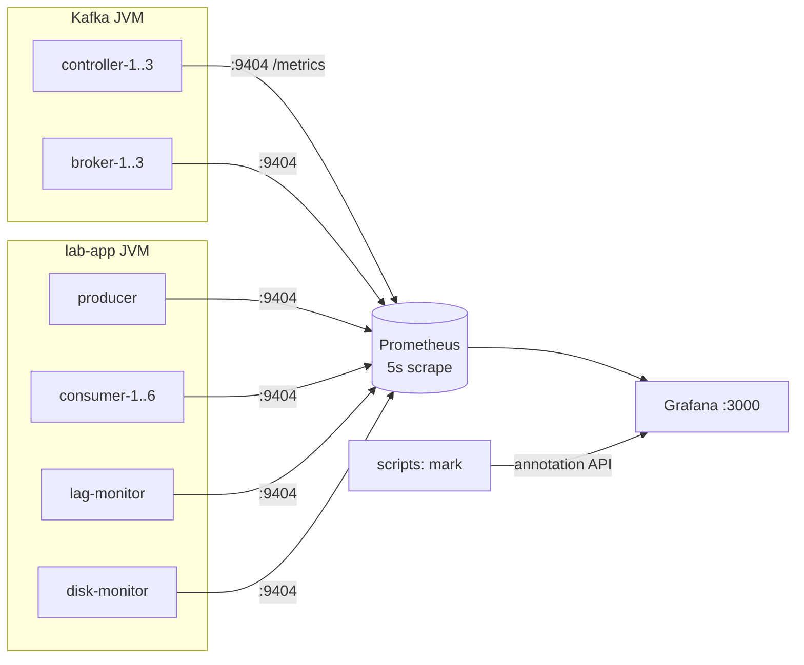

# 02. 모니터링 (Prometheus + Grafana)

모든 단계에서 같은 대시보드로 클러스터와 클라이언트를 관측한다. `cluster.sh up`이 Kafka와 함께 Prometheus, Grafana, disk-monitor를 띄우므로 별도 기동 절차는 없다.

## 목적

- Stage 1에서는 CSV 분석 결과(리밸런싱 시간, 정지 파티션, lag 피크)가 대시보드에서 어떤 모양으로 보이는지 대응시킨다. 이후 단계에서는 CSV 없이 대시보드만으로 같은 판단을 해야 한다.
- Stage 2에서는 장애마다 어떤 패널에 어떤 흔적이 남는지 목록을 만든다. 이 목록이 Stage 3 블라인드 훈련의 진단 근거가 된다.
- 실무 대시보드를 설계할 때 필요한 메트릭 이름, 단위, 함정(윈도우, 누적값, 샘플링 주기)을 미리 익힌다. 커리큘럼 Phase 6의 대시보드 산출물과 이어진다.

## 개요



| 구성 요소 | 내용 |
|---|---|
| JMX exporter | `jmx_prometheus_javaagent` 1.7.0을 javaagent로 붙인다. Kafka 이미지는 `docker/kafka/Dockerfile`, 앱 이미지는 `lab-app/Dockerfile`에서 내려받는다. 모든 JVM이 컨테이너 내부 9404 포트로 `/metrics`를 노출한다. |
| 규칙 파일 | `monitoring/jmx/kafka.yml`(controller, broker), `monitoring/jmx/client.yml`(앱). 컨테이너에 읽기 전용으로 마운트하므로 수정 후 해당 컨테이너만 재시작하면 반영된다. |
| Prometheus | `prom/prometheus:v3.5.0`, `http://localhost:9090`. 5초 간격 수집, 3일 보존. 대상은 `monitoring/prometheus/prometheus.yml`의 컨테이너 이름을 5초마다 DNS로 찾는다(`dns_sd_configs`). 컨테이너가 없으면 대상 목록에서 빠지며 정상이다(예: 증설 전 consumer-4~6). |
| Grafana | `grafana/grafana-oss:12.1.1`, `http://localhost:3000`. 익명 Admin으로 로그인 없이 연다. 데이터소스와 대시보드는 프로비저닝된다. |
| disk-monitor | 브로커는 로그 디렉터리 여유 공간을 JMX로 내보내지 않는다. 브로커 데이터 볼륨을 읽기 전용으로 마운트해 `lab_disk_*`로 노출하는 보조 프로세스다. |
| 어노테이션 | 스크립트의 `mark()`가 Grafana annotation API로 이벤트(주입, 재시작, 조치)를 남긴다. 대시보드의 주황색 세로선이다. Stage 3에서는 정답이 드러나므로 끈다(`LAB_ANNOTATE=0`). |

### 대시보드

| 대시보드 | 용도 | 주요 패널 |
|---|---|---|
| Lab / Overview | 첫 화면. 이상 여부와 영향 범위를 판단한다. | 클러스터 상태(active controller, URP, under min ISR, offline, 디스크 여유), 생산·브로커 유입·소비 처리량, 그룹 상태 타임라인, 커밋 lag(합계·파티션별), 멤버별 할당, 커밋 실패, 브로커별 Produce/Fetch p99 |
| Lab / Cluster | 브로커·컨트롤러 원인 분석 | 처리량, 요청 핸들러·네트워크 유휴율, 요청 지연 p99와 분해(remote/local/queue), purgatory, ISR shrink/expand, 리더 수, 디스크와 로그 크기, log start offset, Raft 리더·epoch·커밋 지연, 그룹 코디네이터 |
| Lab / Clients | 컨슈머·프로듀서 원인 분석 | 멤버·파티션별 처리량, fetch lag, poll 간격, poll idle ratio, 하트비트·커밋 지연, 리밸런싱 지연, poison·오프셋 점프, HW-LSO 차이, 프로듀서 지연·오류·버퍼·노드별 지연 |

대시보드 JSON은 `monitoring/grafana/gen_dashboards.py`가 생성한다. 패널을 바꾸려면 생성기를 수정하고 `python3 monitoring/grafana/gen_dashboards.py`를 실행한 뒤 Grafana를 새로 고친다. UI에서 직접 고친 내용은 컨테이너를 다시 만들면 사라진다.

## 진행 방식

### 1. 기동 확인

```bash
./scripts/cluster.sh up        # 출력 마지막의 "prometheus targets"에서 controller, broker, disk-monitor가 up
open http://localhost:3000     # Lab / Overview가 홈 화면
```

클러스터 상태 줄이 Active controller 1, Brokers up 3, 나머지 0이면 정상이다. 앱을 띄우기 전이므로 흐름과 그룹 패널은 비어 있다.

### 2. Stage 1 실험 1칸을 대시보드로 따라가기

```bash
./scripts/run.sh cooperative kill9
```

실행하는 동안 Overview를 열어 둔다. 주황색 선(TRIGGER, KILL9)이 찍힌 뒤 다음 순서로 확인한다.

1. Consumer processed에서 consumer-3의 처리량이 0이 되고, 다른 멤버의 합계가 유입보다 작아진다.
2. 45초(세션 타임아웃) 동안 Group state는 Stable로 남는다. 브로커는 아직 장애를 모른다.
3. 45초 뒤 그룹 상태가 바뀌고 Assigned partitions per member에서 consumer-3의 파티션이 다른 멤버로 옮겨 간다.
4. Committed lag이 올라갔다가 내려온다. 피크 높이와 회복 시점을 `summary.md`의 값과 비교한다.

차이가 나는 이유를 설명할 수 있어야 한다. Prometheus는 5초, lag-monitor는 1초 간격으로 샘플링하고, `rate()`는 30초 윈도우를 쓴다. 짧은 리밸런싱은 대시보드에서 보이지 않을 수 있다.

### 3. 직접 질의하기

Prometheus UI(`http://localhost:9090`)나 Grafana Explore에서 질의한다. 스크립트에서는 `scripts/promq.py`를 쓴다.

```bash
python3 scripts/promq.py value 'sum(kafka_server_replicamanager_underreplicatedpartitions)'
python3 scripts/promq.py wait 'lab_group_totallag' '<' 500 --timeout 300
```

자주 쓰는 질의:

| 목적 | PromQL |
|---|---|
| 토픽 유입(브로커별) | `sum by (instance) (rate(kafka_server_brokertopicmetrics_messagesin_total{topic="lab-events"}[30s]))` |
| Produce p99와 복제 대기 | `kafka_network_requestmetrics_totaltimems{request="Produce",quantile="0.99"}`, `...remotetimems{...}` |
| 파티션별 커밋 lag | `lab_partition_lag` |
| 그룹 현재 상태 | `lab_group_state_active == 1` (state 라벨) |
| poll 간격 위험 | `max(kafka_consumer_consumer_metrics_time_between_poll_max)` |
| 프로듀서가 막히는가 | `kafka_producer_producer_metrics_bufferpool_wait_ratio`, `rate(lab_producer_skippedtotal[30s])` |
| 디스크 여유율 | `lab_disk_usablebytes / lab_disk_totalbytes` |

## 메트릭 이름 규칙

| 접두어 | 출처 | 예 |
|---|---|---|
| `kafka_server_*`, `kafka_network_*`, `kafka_controller_*`, `kafka_log_*`, `kafka_cluster_*` | 브로커·컨트롤러 MBean. Yammer meter는 `_total` 카운터, histogram은 `quantile` 라벨, KafkaMetric 형식(raft-metrics 등)은 속성명을 이름 끝에 붙인다. | `kafka_server_replicamanager_isrshrinks_total`, `kafka_server_raft_metrics_commit_latency_avg` |
| `kafka_consumer_*`, `kafka_producer_*` | 클라이언트 `metrics()`. `client_id`, `topic`, `partition`, `node_id` 라벨 | `kafka_consumer_consumer_fetch_manager_metrics_records_lag_max` |
| `lab_*` | 실험 앱 자체 지표(`lab` 도메인 MBean) | `lab_consumer_processedtotal`, `lab_partition_lag`, `lab_disk_usablebytes` |
| `jvm_*` | JMX exporter 기본 JVM 지표 | `jvm_memory_used_bytes{area="heap"}` |

알아 둘 함정:

- 클라이언트 메트릭의 `*-total` 속성은 게이지로 수집되며 이름에서 `_total`이 빠진다(예: `..._coordinator_metrics_rebalance`). 증가량은 `increase()`로 구한다. 프로세스가 재시작하면 0부터 다시 센다.
- 클라이언트 `*-avg`, `*-max`, `*-rate`는 클라이언트 내부의 30초 샘플 윈도우(`metrics.sample.window.ms` × `metrics.num.samples`) 값이다. 짧은 스파이크는 평균에 묻히고, 사건이 끝난 뒤에도 최대 1분간 남는다.
- `lab_partition_lag`은 커밋 오프셋 기준이다. 컨슈머가 처리했지만 커밋하지 못한 레코드도 lag으로 보인다. fetch 위치 기준인 `records_lag`과 다르다.
- `lab_*` 카운터와 그룹 지표는 run마다 새로 시작한다. lag-monitor는 run의 그룹 하나만 본다.
- 컨테이너를 다시 만들면 Docker가 이전 IP를 다른 컨테이너에 줄 수 있다. 이름을 고정 대상으로 두면 Prometheus가 열린 연결로 엉뚱한 컨테이너를 계속 수집한다(실제로 lag-monitor 대상에 프로듀서 지표가 쌓였다). 그래서 DNS 디스커버리로 매번 IP를 찾는다.
- 브로커 `kafka_server_replicamanager_underreplicatedpartitions`는 리더 브로커가 보고한다. 브로커가 죽으면 그 브로커가 리더였던 파티션은 리더가 옮겨 간 뒤에야 다시 집계된다.

## 확인할 것

- Overview 클러스터 상태 줄의 각 값이 0이 아닐 때 어떤 장애를 뜻하는지 설명할 수 있는가.
- Produce total time이 늘었을 때 remote time과 local time 중 어느 쪽이 늘었는지로 무엇을 구분할 수 있는가.
- 커밋 lag과 fetch lag이 다르게 움직이는 상황을 하나 이상 들 수 있는가.

## 재현 충실도

Prometheus 수집 간격(5초)과 클라이언트 메트릭 윈도우(30초) 때문에 1초 미만의 사건은 대시보드에 보이지 않는다. Stage 1의 정밀 수치는 CSV 분석(`analyze.py`)이 기준이고, 대시보드는 경향과 상관관계를 보는 도구로 쓴다.
