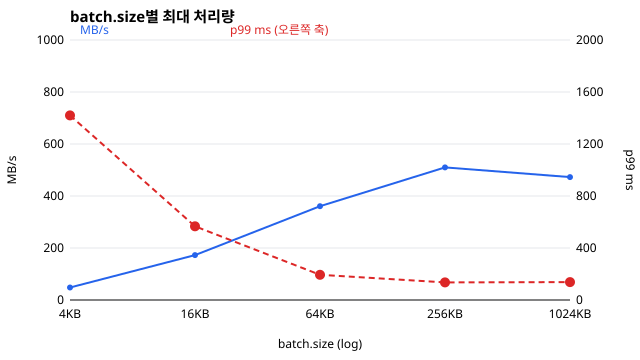
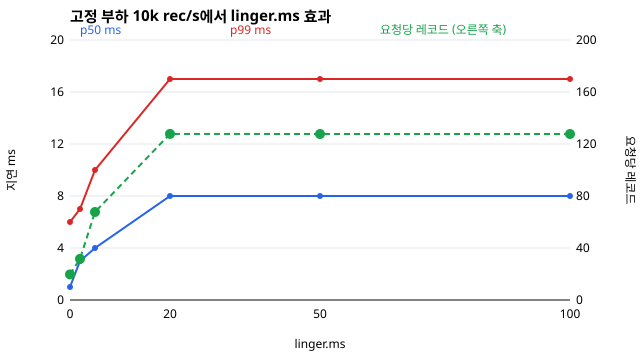
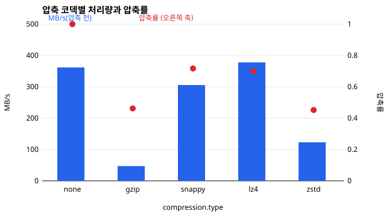
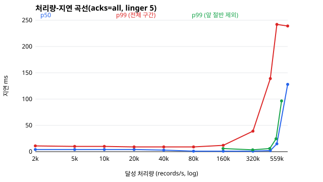

# Stage 1-01. 프로듀서 내부와 설정별 결과

`send()` 한 번이 브로커 로그에 닿고 응답이 돌아오기까지의 경로를 먼저 따라간다. 측정 결과는 이 경로 위에서 읽는다. 줄 번호는 4.1.2 릴리스 소스 기준이다. 프로듀서 파일은 `clients/src/main/java/org/apache/kafka/clients/producer/` 아래에 있고, 브로커 파일은 `core/src/main/scala/kafka/` 아래에 있다.

## 프로듀서 내부 구조

### 두 스레드가 나눠 하는 일

프로듀서는 스레드 두 개로 동작한다. `send()`를 부른 애플리케이션 스레드는 레코드를 배치에 넣기까지만 하고 네트워크를 건드리지 않는다. 브로커로 보내고 응답을 받는 일은 백그라운드의 `Sender` 스레드 하나가 맡는다.

1. 파티션을 정한다(`KafkaProducer.java:1017`). 키가 있으면 키 해시로 정한다. 키가 없으면 `BuiltInPartitioner`가 정하는데, 한 파티션에 `batch.size`만큼 보낼 때까지 같은 파티션을 유지한다(`internals/BuiltInPartitioner.java:223`). 레코드마다 파티션을 바꾸면 배치가 파티션 수만큼 잘게 쪼개지기 때문이다. perf-test는 키를 쓰지 않으므로 이 경로를 탄다.
2. 배치에 넣는다(`internals/RecordAccumulator.java:275`). 파티션마다 배치 큐가 있고, 마지막 배치에 자리가 없으면 `buffer.memory`에서 `batch.size`만큼 새로 빌린다(`:329`, `:333`). 버퍼가 바닥나면 애플리케이션 스레드는 `BufferPool.allocate()`에서 최대 `max.block.ms`까지 멈춘다(`internals/BufferPool.java:107`). 이 시간이 `bufferpool-wait-*` 메트릭이다.
3. 압축도 이 단계에서 일어난다. 배치는 압축 스트림을 열어 둔 채 레코드를 쓰므로(`MemoryRecordsBuilder.java:143`) 압축 CPU는 `send()`를 부른 스레드가 낸다. Sender가 아니다.
4. 새 배치가 생겼거나 배치가 차면 Sender를 깨운다(`KafkaProducer.java:1043`).
5. Sender는 보낼 수 있는 노드를 고르고(`internals/Sender.java:382`), 노드별로 배치를 꺼내(`:417`) 요청을 만든다(`:452`).

### 배치가 떠나는 조건

배치는 "꽉 차거나 linger가 지나면" 떠난다고 흔히 말하지만 조건은 그보다 많다. `RecordAccumulator.batchReady()`(`:603`)의 `sendable`(`:610`)은 다음 중 하나가 참이면 성립한다.

| 조건 | 의미 |
|---|---|
| full | 배치가 찼거나, 같은 파티션에 다음 배치가 이미 쌓여 있다(`:706`) |
| expired | 배치가 만들어진 뒤 `linger.ms`가 지났다(`:608`) |
| exhausted | 버퍼를 기다리는 스레드가 있다(`:661`) |
| closed, flush, 트랜잭션 완료 | 프로듀서를 닫거나 flush하는 중이다 |

두 가지를 기억해 둔다. 배치가 linger보다 빨리 차는 부하에서는 linger가 아무 일도 하지 않는다. 버퍼가 바닥나면 exhausted가 참이 되어 linger를 무시하고 바로 보낸다. `linger.ms` 기본값은 3.9까지 0이었고 4.0부터 5다.

### 요청 하나에 실리는 것

`drainBatchesForOneNode()`(`RecordAccumulator.java:847`)는 노드 하나에 대해 그 노드가 리더인 파티션을 돌면서 파티션마다 배치를 하나씩 꺼내고, 합이 `max.request.size`(기본 1MB)를 넘으면 멈춘다(`:884`). 그러므로 요청 크기의 상한은 "그 브로커가 리더인 파티션 수 × batch.size"와 `max.request.size` 중 작은 값이다. 측정 토픽은 파티션 6개, 브로커 3대라 브로커마다 리더가 2개이고, batch.size가 64KB면 요청 하나는 약 128KB다.

### 브로커가 요청을 처리하는 순서

네트워크 스레드(기본 3개)가 요청을 다 읽으면 요청 큐에 넣고 그 연결을 mute한다(`network/SocketServer.scala:1054-1055`). 응답을 보낸 뒤에야 연결을 다시 읽는다(`:1089`). 한 연결 안에서 요청 순서를 지키기 위해서다. 이 때문에 연결 하나에서 브로커가 동시에 처리하는 요청은 하나뿐이다. 프로듀서의 `max.in.flight.requests.per.connection=5`는 요청 5개까지 소켓에 밀어 넣을 수 있다는 뜻이고, 브로커가 5개를 동시에 처리한다는 뜻이 아니다.

큐에서 요청을 꺼낸 I/O 스레드(기본 8개)가 레코드를 검증하고 로그에 쓴다. 그다음은 acks에 따라 갈린다.

| acks | 로그에 쓴 뒤 | 코드 |
|---|---|---|
| all | 요청을 purgatory에 넣고 I/O 스레드를 돌려준다. 팔로워가 따라오면 응답한다 | `server/ReplicaManager.scala:908` |
| 1 | 바로 응답한다. 대기는 acks가 -1일 때만 한다 | `server/ReplicaManager.scala:1355` |
| 0 | 응답하지 않는다. 오류가 나면 연결을 끊어서 알린다 | `server/KafkaApis.scala:499` |

`acks=all`의 완료 조건은 high watermark가 이 배치의 끝을 넘는 것이다(`cluster/Partition.scala:1089`). 리더는 팔로워의 진행을 팔로워의 다음 fetch 요청에 담긴 오프셋으로만 안다(`:909`). 그래서 복제 대기는 "팔로워가 데이터를 가져가고, 그다음 fetch로 여기까지 받았다고 알릴 때까지"다. high watermark는 ISR 전원이 넘어야 오르므로(`:1152`) 가장 늦은 ISR 복제본이 이 시간을 정한다. `min.insync.replicas`는 기다릴 복제본 수가 아니라, ISR이 이 수보다 작으면 쓰기를 거부하는 조건이다(`:1370`).

### 지연을 읽는 곳

| 구간 | 지표 | 위치 |
|---|---|---|
| `send()`부터 콜백까지 전체 | perf-test의 p50, p99 | 프로듀서 |
| 배치가 accumulator에서 기다린 시간 | `record-queue-time-avg` | 프로듀서 |
| 요청을 만든 뒤 응답을 읽기까지 | `request-latency-avg` | 프로듀서 |
| 앱 스레드가 버퍼를 기다린 시간 | `bufferpool-wait-time-ns-total` | 프로듀서 |
| Sender가 네트워크 이벤트를 기다린 시간 | `io-wait-time-ns-total` | 프로듀서 |
| I/O 스레드를 기다린 시간 | `RequestQueueTimeMs` | 브로커 |
| 검증과 로그 쓰기 | `LocalTimeMs` | 브로커 |
| 복제 대기 | `RemoteTimeMs` | 브로커 |
| 네트워크 스레드를 기다린 시간 | `ResponseQueueTimeMs` | 브로커 |

프로듀서 쪽 요청 지연과 브로커 쪽 합계의 차이는 요청이 연결에서 줄을 선 시간과 Sender가 응답을 늦게 읽은 시간이다. 이 차이를 보면 시간이 브로커 안에서 쓰이는지 밖에서 쓰이는지 가를 수 있다.

## 측정 결과

환경은 Docker Desktop의 리눅스 VM(10코어, 메모리 8GB), 브로커 3대(코어 제한 없음), 프로듀서 컨테이너 4코어다. 레코드는 510B, 토픽은 파티션 6개, RF 3, `min.insync.replicas=2`다. 모든 값은 AC 전원에 덮개를 연 채로 끊김 없이 돌린 한 세션(53분, 202회 측정)에서 나왔다. 표의 값은 3회 반복의 중앙값이고, `load-steady`는 6회다. 괄호 안은 회차별 값이다. perf-test의 MB는 1,048,576바이트다.

"브로커 시간"은 Produce 요청 하나가 브로커 안에서 쓴 평균 시간(`TotalTimeMs`)이다. 절대값은 이 노트북의 값이고, 디스크가 메모리이며 네트워크 왕복이 거의 0이라는 점을 잊지 않고 읽는다.

### acks

| acks | 최대 부하 MB/s | 10k rec/s의 p50 | p99 | 요청 지연 | 브로커 시간 |
|---|---|---:|---:|---:|---:|
| all | 327 (302, 327, 332) | 4ms | 10ms | 1.3ms | 0.74ms |
| 1 | 408 (408, 393, 486) | 4ms | 8ms | 0.6ms | 0.10ms |
| 0 | 486 (404, 486, 505) | 3ms | 7ms | 없음 | 0.08ms |

1. `acks=all`이 `acks=1`에 더한 시간은 브로커에서 0.64ms, 프로듀서 요청 지연에서 0.7ms로 맞아떨어진다. 이 차이가 복제 대기다. `RemoteTimeMs` 평균(0.34ms)이 더 작게 나오는 이유는 단계별 시간이 정수 ms로 반올림되어 쌓이기 때문이다(`network/RequestChannel.scala:241`). 1ms보다 작은 값은 합계로 비교한다.
2. 0.6ms는 컨테이너가 같은 호스트에 있어 왕복이 거의 0이기 때문에 나온 값이다. 실제 네트워크에서는 팔로워 fetch의 왕복만큼 더해진다. 옮겨 갈 것은 절대값이 아니라 "복제 대기는 remote에 쌓이고 프로듀서 요청 지연과 맞아떨어진다"는 구조다.
3. 고정 부하의 p50은 acks와 거의 무관하다. 대부분 linger에서 나온다.
4. 최대 처리량은 `acks=all`이 `acks=1`보다 20% 낮다. 복제를 기다리는 동안 I/O 스레드는 풀려나지만 연결은 응답을 보낼 때까지 mute 상태다. 그래서 복제 대기가 곧 연결 점유 시간이 된다. 브로커 시간이 1.02ms면 연결 하나는 초당 약 980건을 넘지 못하고, 측정값은 브로커당 초당 약 900건이다. 복제 자체는 acks와 상관없이 일어나므로 브로커 CPU는 비슷하다(`acks=all` GB당 12초, `acks=1` 13초).
5. acks를 1이나 0으로 바꾸면 멱등 프로듀서가 조용히 꺼진다. `enable.idempotence`를 직접 설정하지 않았을 때의 동작이다(`ProducerConfig.java:597-604`). 그래서 이 표는 acks만이 아니라 멱등성까지 함께 바꾼 비교다.

### batch.size



| batch.size | MB/s | 요청 크기 | 초당 요청 | 브로커 CPU | GB당 CPU | 평균 in-flight | 연결 사용률 | 버퍼 대기 |
|---|---:|---:|---:|---:|---:|---:|---:|---:|
| 4KB | 48 | 7KB | 7,087 | 3.93코어 | 78초 | 5.0 | 28% | 75% |
| 16KB | 173 | 31KB | 5,732 | 3.80코어 | 22초 | 4.8 | 44% | 49% |
| 64KB | 361 | 124KB | 2,989 | 4.02코어 | 11초 | 3.6 | 94% | 9% |
| 256KB | 510 | 467KB | 1,119 | 4.35코어 | 8초 | 1.6 | 62% | 2% |
| 1MB | 473 | 999KB | 484 | 4.20코어 | 8초 | 1.5 | 55% | 1% |

평균 in-flight는 "브로커당 초당 요청 × 요청 지연"이고, 연결 사용률은 "브로커당 초당 요청 × 브로커 시간"이다. 구간마다 처리량을 막는 것이 다르다.

- 4KB, 16KB: 평균 in-flight가 상한 5에 붙어 있다. 요청이 작아서 5개를 실어도 보낼 수 있는 바이트가 적다.
- 64KB: 연결 사용률이 94%다. 브로커가 연결마다 요청을 하나씩 처리하는 구조가 한계다. 브로커 시간 0.94ms면 연결 하나는 초당 약 1,060건을 넘지 못한다.
- 256KB 이상: 연결 사용률이 60% 안팎으로 내려가고 버퍼 대기가 사라진다. 뒤쪽에 여유가 있는데도 초당 약 100만 레코드에서 멈춘다. `acks=0`도 같은 값에서 멈추므로 앱 스레드 쪽의 한계로 본다. 프로듀서 JVM이 1.5초만 돈 결과라 앱 스레드의 상한이라고 보기는 어렵다.

`batch.size` 기본값은 16KB다. 이 측정에서 64KB로 올리면 브로커 CPU는 6% 늘고 처리량은 2.1배가 된다.

### 브로커 CPU 모델

batch, linger, load 묶음에서 고른 13개 점으로 회귀하면 브로커 CPU는 다음 식으로 맞는다. 측정값과의 차이는 15% 이내다.

```text
브로커 3대 합계(코어) ≈ 0.47 + 0.40ms × 초당 요청 수 + 6.9ms × 초당 MB
```

0.47코어는 부하가 없어도 드는 값이다. 요청마다 드는 고정비와 바이트마다 드는 변동비가 따로 있다는 것이 핵심이다. batch를 키우면 같은 바이트를 적은 요청으로 보내므로 앞의 항이 줄어든다. 4KB 배치에서는 1MB를 보내는 데 약 146개 요청이 들어 고정비(58ms)가 변동비(6.9ms)의 여덟 배가 넘는다. 64KB 배치에서는 약 8개 요청이라 고정비가 3.3ms로 줄어든다. 계수는 RF 3 기준이고 복제 비용까지 들어 있다.

### linger.ms

부하를 10k rec/s(4.9MB/s)로 고정했다.



| linger.ms | p50 | p99 | 평균 배치 | 요청당 레코드 | 초당 요청 | 브로커 CPU |
|---:|---:|---:|---:|---:|---:|---:|
| 0 | 1ms | 6ms | 10KB | 20 | 508 | 0.79코어 |
| 2 | 3ms | 7ms | 16KB | 32 | 316 | 0.67코어 |
| 5 | 4ms | 10ms | 34KB | 68 | 148 | 0.65코어 |
| 20 | 8ms | 17ms | 59KB | 128 | 78 | 0.53코어 |
| 50 | 8ms | 17ms | 59KB | 128 | 78 | 0.58코어 |
| 100 | 8ms | 17ms | 58KB | 128 | 78 | 0.53코어 |

1. linger 20ms에서 곡선이 멈춘다. 초당 4.9MB면 64KB 배치가 13ms에 차므로, 그보다 긴 linger는 쓰이지 않는다. 앞에서 본 배치가 떠나는 조건 중 full이 먼저 참이 된다.
2. p50은 "배치가 열려 있는 시간의 절반 + 요청 지연"으로 읽을 수 있다. 레코드가 고르게 들어오므로 평균 대기가 열린 시간의 절반이기 때문이다. linger 5ms면 2.5 + 1.1 = 약 4ms, 배치가 13ms에 차는 구간이면 6.5 + 1.8 = 약 8ms다.
3. `linger.ms=0`이어도 요청당 레코드가 20이다. Sender가 앞 요청을 처리하는 사이에 레코드가 쌓이기 때문이다.
4. 요청이 여섯 배 줄어도 브로커 CPU는 0.2코어쯤만 준다. 모델의 고정비 항(0.40ms × 약 430건 = 0.17코어)과 비슷하다. 저부하에서는 linger가 지연을 더하는 만큼 얻는 것이 작다.

### 압축

최대 부하(batch 128KB, linger 20ms)의 처리량은 압축 전 기준이다. 압축률은 압축 후 크기 ÷ 압축 전 크기다.



| 코덱 | 압축률 | 압축 전 MB/s | 전송 MB/s | p50 | 프로듀서 CPU | 버퍼 대기 |
|---|---:|---:|---:|---:|---:|---:|
| none | 1.00 | 362 (300, 362, 370) | 362 | 134ms | 1.96코어 | 12% |
| gzip | 0.46 | 47 (45, 48, 47) | 22 | 5ms | 1.20코어 | 0% |
| snappy | 0.72 | 306 (304, 306, 339) | 219 | 3ms | 1.90코어 | 0% |
| lz4 | 0.70 | 378 (279, 378, 402) | 264 | 3ms | 1.99코어 | 0% |
| zstd | 0.45 | 123 (120, 126, 123) | 56 | 2ms | 1.38코어 | 0% |

처리량이 코덱마다 달라 위 표로는 CPU와 지연을 비교할 수 없다. 40k rec/s(압축 전 19.5MB/s)로 고정해 다시 쟀다.

| 코덱 | p50 | p99 | 요청당 레코드 | local 시간 | 브로커 CPU | 프로듀서 CPU |
|---|---:|---:|---:|---:|---:|---:|
| none | 5ms | 23ms | 258 | 0.17ms | 0.73코어 | 0.34코어 |
| gzip | 8ms | 16ms | 484 | 1.01ms | 0.51코어 | 0.61코어 |
| snappy | 6ms | 12ms | 324 | 0.24ms | 0.68코어 | 0.36코어 |
| lz4 | 6ms | 12ms | 330 | 0.13ms | 0.61코어 | 0.34코어 |
| zstd | 9ms | 17ms | 487 | 0.74ms | 0.59코어 | 0.42코어 |

1. 압축률은 gzip과 zstd가 비슷하게 가장 좋고, zstd가 2.6배 빠르다. lz4의 처리량은 압축하지 않을 때와 회차 편차 안에서 같고 전송 바이트는 30% 적다. 이 페이로드는 값이 무작위라 압축이 잘 안 되는 편이므로, 압축률은 실제 데이터로 다시 재야 한다.
2. gzip과 zstd의 처리량이 낮은 이유는 앱 스레드다. 버퍼 대기가 0이고 p50이 2~5ms이므로 뒤쪽은 비어 있다. 압축이 `send()`를 부른 스레드에서 돌기 때문이다. 프로듀서 한 대의 한계이지 클러스터의 한계가 아니다.
3. 같은 부하에서 브로커 CPU는 압축해도 늘지 않았다(none 0.73코어, 나머지 0.51~0.68코어). 전송 바이트가 주는 효과가 브로커가 압축을 푸는 비용보다 크거나 비슷하다. 프로듀서 CPU는 gzip에서 두 배 가까이 늘어난다.
4. 브로커는 압축을 푼다. local 시간이 none 0.17ms에서 gzip 1.01ms, zstd 0.74ms로 늘어난다. 코덱이 같으면 다시 압축하지는 않고(`storage/.../LogValidator.java:305`), 키와 값을 건너뛰는 반복자로 레코드 헤더만 검증한다(`:337`). 그래도 건너뛰려면 압축 스트림을 읽어야 하므로 푸는 비용은 남는다(`clients/.../DefaultRecordBatch.java:354`). 토픽의 `compression.type`을 프로듀서와 다르게 두면 재압축이 일어나는데, 이 경우는 재지 않았다.
5. 압축하면 p50이 오른다. 압축 CPU 때문이 아니라 배치가 늦게 차기 때문이다. 같은 128KB에 레코드가 두 배 들어가므로(요청당 258 → 484) 차는 시간이 6ms에서 14ms로 늘고, p50도 그 절반만큼 는다.

### 부하와 포화점



`load-steady`는 앞 절반을 통계에서 뺀 값이다. 점마다 Prometheus 수집을 켠 측정과 멈춘 측정을 번갈아 6회씩 쟀다. p50, 요청 지연, 브로커 시간, CPU는 수집을 멈춘 쪽의 값이다. 맨 아래 줄만 `load` 묶음의 값이다.

| 목표 rec/s | MB/s | p50 | p99 (수집 멈춤) | p99 (수집 켬) | 요청 지연 | 브로커 시간 | 브로커 CPU |
|---:|---:|---:|---|---:|---:|---:|---:|
| 160k | 77 | 1ms | 6ms (4, 4, 16, 4, 8, 27) | 4ms (4, 4, 4, 4, 5, 4) | 0.9ms | 0.23ms | 1.08코어 |
| 320k | 155 | 1ms | 4ms (4, 3, 3, 13, 18, 3) | 4ms (5, 4, 21, 4, 8, 4) | 1.1ms | 0.15ms | 1.79코어 |
| 480k | 230 | 1ms | 6ms (7, 4, 12, 6, 6, 6) | 20ms (6, 24, 32, 234, 13, 17) | 1.8ms | 0.30ms | 2.63코어 |
| 560k | 267 | 2ms | 24ms (18, 15, 29, 20, 39, 29) | 94ms (62, 8, 125, 266, 202, 44) | 2.1ms | 0.41ms | 3.04코어 |
| 640k | 303 | 55ms | 96ms (22, 27, 202, 205, 166, 27) | 52ms (42, 25, 96, 61, 166, 11) | 3.3ms | 0.79ms | 3.44코어 |
| 무제한 | 349 (376, 349, 320) | 128ms | 239ms | - | 3.7ms | 0.95ms | 3.95코어 |

1. 곡선은 267MB/s까지 평평하다. 포화(약 349MB/s)의 77%까지 p50은 1~2ms이고 p99는 4~24ms다. 303MB/s(87%)부터는 실행마다 갈려서, 같은 목표가 p99 22ms로 끝나기도 하고 205ms로 끝나기도 한다. 제한을 풀면 p50이 128ms로 뛴다. 여유가 있는 동안은 배치가 바로 떠나고, 유입이 처리량을 넘는 순간 초과분이 전부 버퍼에 쌓이기 때문이다. 버퍼 64MB ÷ 349MB/s = 약 183ms가 이 구간 지연의 기준이고, 측정값 p50 128ms와 p99 239ms가 그 앞뒤에 있다.
2. 그래프의 빨간 선은 앞부분까지 포함한 `load` 묶음의 p99다. 320k rec/s에서 39ms로, 같은 부하에서 앞 절반을 뺀 값(4ms)의 열 배다. 480k rec/s는 139ms 대 20ms다. 측정이 짧으면 프로듀서 JVM이 데워지는 구간이 p99를 차지한다. 프로세스가 막 뜬 직후의 지연이 이만큼 다르다는 뜻이기도 하다.
3. 낮은 부하에서는 부하가 오를수록 p50이 내려간다. `load` 묶음에서 2k~20k rec/s의 p50은 4ms이고 80k rec/s부터 1ms다. 부하가 높을수록 배치가 linger보다 빨리 차기 때문이다.
4. Prometheus 수집은 높은 부하에서 p99를 올린다. 브로커 exporter 수집은 브로커당 평균 0.39초 걸리고 5초마다 돈다. 320k rec/s 이하에서는 차이가 없고, 480k rec/s에서 6ms 대 20ms, 560k rec/s에서 24ms 대 94ms다. 회차별 값이 4~266ms로 크게 흔들리므로 배율을 일반화하지는 않는다. 어떤 잠금이나 자원에서 막히는지도 확인하지 않았다.
5. 포화에 가까울수록 한 번의 정지가 오래 남는다. 이용률 u에서 S초 정지하면 밀린 양을 되찾는 데 S × u/(1−u)초가 더 든다. 곡선이 평평하다고 포화 직전까지 쓰면 안 되는 이유다. 용량 산정은 이 점을 반영한다.

### max.in.flight.requests.per.connection

| in-flight | MB/s | 요청 지연 | 브로커 시간 | 연결 사용률 | 버퍼 대기 |
|---:|---|---:|---:|---:|---:|
| 1 | 335 (353, 285, 335) | 1.0ms | 0.82ms | 75% | 16% |
| 2 | 354 (354, 338, 398) | 1.8ms | 0.96ms | 93% | 16% |
| 5 | 297 (289, 364, 297) | 4.3ms | 1.13ms | 93% | 20% |

in-flight를 다섯 배로 늘려도 처리량은 회차 편차 안에서 그대로이고 요청 지연은 네 배가 된다. 브로커가 연결마다 요청을 하나씩 처리하므로, 늘어난 요청은 동시에 처리되지 않고 소켓 앞에서 줄을 선다. 왕복 지연이 큰 네트워크에서는 in-flight의 효과가 이보다 크다. 이 랩은 왕복이 거의 0이라 in-flight가 1이어도 연결이 거의 쉬지 않는다.

### 브로커 CPU 제한

프로듀서 하나로는 브로커를 포화시킬 수 없어서, `docker update --cpus`로 브로커 CPU를 줄여 브로커가 먼저 차게 했다.

| 브로커당 코어 | MB/s | 브로커 CPU 합 | 코어당 MB/s | 요청 지연 | 브로커 시간 | 요청 큐 | p99 | 버퍼 대기 |
|---:|---|---:|---:|---:|---:|---:|---:|---:|
| 0.5 | 79 (79, 75, 120) | 1.56코어 | 52 | 18.7ms | 4.55ms | 0.12ms | 1548ms | 69% |
| 1 | 298 (163, 298, 312) | 3.41코어 | 99 | 4.2ms | 1.12ms | 0.01ms | 272ms | 27% |
| 2 | 350 (271, 350, 363) | 4.19코어 | 제한에 닿지 않음 | 3.7ms | 0.94ms | 0.01ms | 214ms | 11% |

1. 0.5코어와 1코어에서는 CPU가 제한에 닿아 있다. 브로커 포화다. CPU 합이 제한보다 조금 크게 나오는 것은 측정 앞뒤의 구간까지 세기 때문이다. 회차별 코어당 유입은 50~104MB/s로 두 배 갈린다. 이 값은 RF 3, batch 64KB에서 브로커 3대의 코어를 합쳐 나눈 유입량이다. 2코어에서는 브로커당 1.4코어만 쓰고 프로듀서 쪽이 먼저 막힌다.
2. 이 포화는 요청 큐에 보이지 않는다. 요청 큐 대기는 0.12ms인데 프로듀서가 본 요청 지연은 18.7ms다. 브로커의 요청 타이머는 네트워크 스레드가 요청을 다 읽은 뒤에 시작하므로(`network/SocketServer.scala:1042`) 소켓에서 기다린 시간이 브로커 지표에 없다. 브로커 포화를 판단할 때는 프로세스 CPU와 프로듀서의 요청 지연을 함께 본다.

### 포화 원인을 찾으며 버린 가설

프로듀서 하나의 한계와 p99 급등의 원인을 찾는 동안 그럴듯한 설명이 여러 번 틀렸다. 지표 하나로 원인을 단정하면 어떻게 되는지 보여 주는 기록으로 남긴다.

| 가설 | 시험 | 결과 |
|---|---|---|
| Sender 스레드가 코어 하나를 다 쓴다 | 스레드별 CPU를 0.2초 간격으로 읽었다 | 전송 구간에서 0.5코어 안팎. Sender는 시간의 36%를 네트워크 이벤트를 기다리며 보낸다 |
| in-flight × 요청 크기로 정해지는 전송 창이 막는다 | in-flight를 1, 2, 5로 바꿨다 | 처리량은 편차 안에서 그대로, 요청 지연만 네 배 |
| 프로듀서 GC가 전체를 멈춘다 | GC 로그를 남기고 힙을 1.5GB까지 늘렸다 | 정지 비율 4~9%, 최대 42ms |
| 브로커 GC가 p99를 밀어 올린다 | 측정 전체의 Young GC를 봤다 | 3,046회, 평균 4.7ms |
| Prometheus 수집이 p99를 열 배 넘게 밀어 올린다 | 수집을 켠 측정과 멈춘 측정을 시간대를 달리해 쟀더니 119ms 대 4ms였다 | 앞 측정은 배터리, 뒤 측정은 AC였다. 같은 시간대에 번갈아 재자 같은 부하에서 4ms 대 4ms였다 |

## 측정 도구에서 배운 것

측정값이 틀렸던 이유들이다. 다른 환경에서 성능을 잴 때도 같은 함정이 있다.

| 함정 | 확인한 값 | 이 랩의 대응 |
|---|---|---|
| 측정이 너무 짧다 | 90MB 상한이면 0.9초 만에 끝나 98MB/s로 나온다. 716MB로 늘리고 브로커를 데우면 같은 `--record-size` 설정이 228MB/s다(둘 다 배터리) | 볼륨 1GB, 측정점은 볼륨의 70% |
| 브로커 JVM이 덜 데워졌다 | 같은 설정을 연달아 재면 124, 201, 313, 352MB/s로 오르고 GB당 CPU는 49초에서 12초로 내려간다 | 측정 4회를 버린다 |
| 프로듀서 JVM이 덜 데워졌다 | 320k rec/s의 p99가 전체 구간 39ms, 앞 절반을 빼면 4ms다 | 정상 상태 곡선은 `--warmup-records`로 잰다 |
| 부하 도구가 먼저 막힌다 | `--record-size`는 레코드마다 난수를 채워 247MB/s에서 앱 스레드가 막힌다(버퍼 대기 0). 페이로드 파일이면 308MB/s다 | 페이로드 파일을 쓴다 |
| 전원이 다르다 | 64KB 최대 처리량이 배터리 세션에서 315MB/s, AC 세션에서 361MB/s다. 320k rec/s의 정상 상태 p99는 119ms와 4ms로 갈렸다. 번갈아 잰 것은 아니어서 차이의 전부가 전원 때문이라고 확정하지는 않는다 | AC에서 한 세션으로 잰다. 측정마다 전원과 덮개 상태를 기록하고, 섞이면 리포트에 경고가 나온다 |
| 비교 대상을 따로 잰다 | 시간대를 달리해 재면 그 사이의 조건 차이가 비교 대상의 차이로 보인다. 수집의 영향을 이렇게 잘못 읽었다 | 같은 시간대에 번갈아 잰다(`load-steady`) |
| 비율 메트릭이 작게 나온다 | 같은 부하의 `io-wait-ratio`가 15초 측정에서 0.32, 45초 측정에서 0.95다. 창이 덜 찬 구간을 창 하나가 더 지난 것으로 나누기 때문이다(`common/metrics/stats/Rate.java:91-95`) | `*-ns-total`을 측정 시간으로 나눈다 |
| 브로커 백분위에 직전 측정이 섞인다 | JMX 백분위는 최근에 가중치를 둔 표본이라 짧은 측정을 잘라 낼 수 없다 | `Mean × Count`의 전후 차이로 구간 평균을 구한다 |
| 유휴율이 늦게 움직인다 | 요청 핸들러 유휴율은 1분 이동 평균이다 | 짧은 측정의 판단에 쓰지 않는다 |
| 토픽을 지워도 디스크가 안 빈다 | 삭제 지연은 토픽 설정이 아니라 브로커 기본값(60초)을 따른다(`log/LogManager.scala:1126`) | 측정 동안 `log.segment.delete.delay.ms`를 낮춘다 |
| 노트북이 잠든다 | 3,023초짜리 측정이 나오고 프로듀서 CPU가 0.01코어로 찍힌다 | `caffeinate`로 실행하고 120초를 넘긴 측정은 버린다 |
